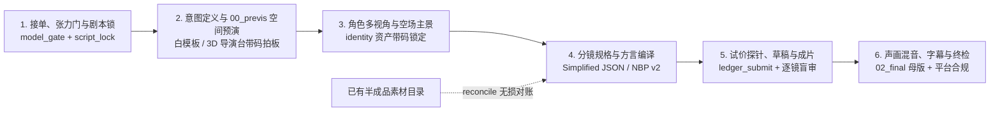

# Seedance Prompt Gen

> **专为 AI 短剧与叙事短片而生的全流程创作与制作 Skill**
> 让创作者与新手都能用几句大白话，在 AI 助手里一键复刻「选题脑暴 → 爆款剧本张力 → 空间机位预演 → 角色多角度锁一致 → 多模型提示词编译 → 声画混音与字幕成片」的导演级工作流。

作者：**Enzo** · 博客：[Enzo Journal](https://blog.enzocreative.me/) · 作品集：[enzocreative.me](https://enzocreative.me/) · 提示词精选库：[AI CAN DO](https://ai.enzocc.net/) · 规范版本：`v7.0.1` · 协议：[MIT](LICENSE)

---

## 一键安装流程

### 1. 环境准备

- **必需**：`Python 3.10+`、`Git`（全部核心状态机、剧本张力门禁与提示词编译器仅依赖 Python 标准库，零额外依赖开箱即用）。
- **按需可选**：
  - `ffmpeg` / `ffprobe`：用于成片音画混音、对白闪避、中文字幕压制与解码抽帧质检；
  - `Node.js 18+`：用于启动内置的本地 3D 交互式导演台（[tools/stage-desk](tools/stage-desk/index.html)）；
  - 各生图 / 生视频 / 音频通道对应的官方 CLI、API Key 或浏览器自动化桥。

### 2. 一行命令自动安装到全部常用 Agent

在终端执行下方命令，将仓库克隆到 `~/.local/share/seedance-prompt-gen`，并自动探测你本机已安装的 AI 编程助手，创建统一的技能软链接与 `/seedance-prompt-gen` 斜杠指令：

```bash
git clone https://github.com/enzoyoyo/seedance-prompt-gen.git ~/.local/share/seedance-prompt-gen && bash ~/.local/share/seedance-prompt-gen/install.sh
```

如果想先只读预览将联动哪些客户端，不写入任何文件，可先运行：

```bash
bash ~/.local/share/seedance-prompt-gen/install.sh --dry-run
```

> 安装器只会探测并接入**本机已存在配置目录**的宿主客户端，绝不会新建多余目录或覆盖已有冲突配置。

### 3. 支持的多 Agent 宿主清单

| Agent 宿主 | 技能软链接位置 | 斜杠指令包装路径 | 触发方式 |
|---|---|---|---|
| Claude Code | `~/.claude/skills/seedance-prompt-gen` | 原生发现 | `/seedance-prompt-gen` |
| Codex CLI | `~/.codex/skills/seedance-prompt-gen` | `~/.codex/prompts/seedance-prompt-gen.md` | `/prompts:seedance-prompt-gen` / `$seedance-prompt-gen` |
| Cursor | `~/.cursor/skills/seedance-prompt-gen` | `~/.cursor/commands/seedance-prompt-gen.md` | `/seedance-prompt-gen` |
| Gemini CLI | `~/.gemini/skills/seedance-prompt-gen` | `~/.gemini/commands/seedance-prompt-gen.toml` | `/seedance-prompt-gen` |
| Antigravity | `~/.gemini/antigravity/skills/seedance-prompt-gen` | `~/.gemini/antigravity/global_workflows/seedance-prompt-gen.md` | `/seedance-prompt-gen` |
| OpenCode | `~/.config/opencode/skills/seedance-prompt-gen` | `~/.config/opencode/commands/seedance-prompt-gen.md` | `/seedance-prompt-gen` |
| Hermes Agent | `~/.hermes/skills/seedance-prompt-gen` | 原生发现 | `/seedance-prompt-gen` |
| Qwen Code | — | `~/.qwen/commands/seedance-prompt-gen.toml` | `/seedance-prompt-gen` |
| Amp / Grok / 通用 Agents | `~/.agents/skills/seedance-prompt-gen`、`~/.config/agents/skills/seedance-prompt-gen`、`~/.grok/skills/seedance-prompt-gen` | 原生发现 | `/seedance-prompt-gen` 或自然语言触发 |

### 4. 可选 API 凭证配置

如果只是写剧本、拆解分镜、出空间预演或生成各模型可直接粘贴的提示词包，**无需配置任何 API Key**。

如果你希望由 Agent 协助探测可用生成通道，可将你的密钥配置到环境变量或 `~/.config/seedance-prompt-gen/.env` 中。内置的探测脚本只会检查**环境变量名是否存在**（`present` / `missing`），绝不会读取、记录或输出任何密钥内容。

---

## 小白上手：怎么调用就能拿到同款导演级输出

装好之后，你不需要记任何复杂参数或专业术语。在任意 Agent 对话框中输入 `/seedance-prompt-gen`（Codex 中用 `/prompts:seedance-prompt-gen`），或者直接用日常中文说出你的想法，Skill 会自动接管节奏、在关键节点带你拍板确认：

### 常见使用与调用示例

- **场景 1 · 没有思路，想找最近有潜力的 AI 短剧选题**
  > `/seedance-prompt-gen 帮我结合当下热点脑暴 3 个适合 AI 制作的竖屏悬疑短剧方向`
  *效果：自动扫描检索工具 → 拆解底层戏剧钩子与观众情绪承诺 → 通过反固化过滤 → 给出带「一句话前提 / 欲望 / 阻力 / 可见代价 / 开场钩子」的候选方案，等你选定再动笔。*

- **场景 2 · 已有模糊想法，想写出能拍、人话味足的短剧剧本**
  > `/seedance-prompt-gen 我想拍一个“深夜代驾意外接到十年前失踪前任订单”的短剧，先帮我诊断故事张力并写出第 1 集剧本`
  *效果：先过八行张力门诊断帮你堵住逻辑漏洞 → 确认后写出带场次、`[S1-B1]` 节拍编号、可演动作线与潜台词对白的完整剧本，并附 ≥5 个跨机制候选片名。*

- **场景 3 · 只要可复制的多模型分镜与提示词包（不花一分钱调用 API）**
  > `/seedance-prompt-gen 把这段剧本拆成逐镜分镜和可复制提示词，分别适配 Seedance 2.5 和 Google Flow，暂不提交生成`
  *效果：自动进入 `prompt_only` 交付模式，保持原剧本台词一字不漏，为你输出直观扁平的 Simplified JSON 及对应模型的精确方言提示词与参考图挂载分工。*

- **场景 4 · 先定机位站位与角色多角度设定图（防变脸、防越轴）**
  > `/seedance-prompt-gen 在 ./my-drama 目录推进这部剧本，先把空间站位白模板和角色需要的所有角度参考图做好给我挑`
  *效果：生成零成本 2D 白模站位/机位图（或联动本地 3D 导演台）让你先用确认码拍板，自动推导出哪位角色需要正面/四分之三侧/正侧/背影图，避免开拍后才发现侧背镜换脸。*

- **场景 5 · 全流程推进成完整短剧成片（`full_film`）**
  > `/seedance-prompt-gen 在 ./my-drama 目录用上面锁定的剧本推进完整成片制作`
  *效果：严格按 SOP 3.0 状态机单步推进，先用低清/草稿档试跑、全部认可后再升成片，最后完成对白闪避混音、中文字幕压制与四栏回放验收。*

- **场景 6 · 接手做了一半的目录，或单镜头崩坏精准抢救**
  > `/seedance-prompt-gen 我目录下已经有之前生成的片段和角色图了，先帮我对账看看缺什么；另外第 3 镜手部动作和道具穿帮了帮我定位修好`
  *效果：先做只读无损盘点保留已有合格素材不重拍；针对翻车镜头只输出「现象 → 原因 → 修复 → 单变量重测」方案，不盲目推倒重抽烧额度。*

---

## 整体功能

1. **双维路由与继承式模型门禁**
   - **交付模式 `delivery_mode`**：`prompt_only`（提示词包）/ `images_only`（角色与场景资产图）/ `video_clips`（逐镜验收视频片段）/ `full_film`（完整成片含配音混音字幕）。
   - **创作模式 `creative_mode`**：`cinema`（留白、动机运镜、偏长镜）与 `short_drama`（`OPEN ON ACTION`、强利害与高密度冲突），与画幅、总时长解耦。
   - **低摩擦继承式选择**：通过 `scripts/model_gate.py` 按「本轮原话 > 项目已锁 > 会话继承」自动对齐模型方案，仅对真正缺失项展示选项并等待人工确认，绝不擅自代签或盲目生图扣费。
2. **热点选题雷达与剧本八项张力硬门**
   - 内置 `validate_script_gate.py`，强制核验「想要 / 阻力 / 代价 / 升级 / 转折 / 钩子 / 结尾 / 标题」八行张力证据与标题三测。
   - 已有剧本使用 `lock_script.py` 锁定：**逐字保留原文**、只补 `[S1-B1]` 节拍编号；多镜分镜交付前由 `check_script_coverage.py` 强制逐句对账，确保台词不丢不改。
3. **零成本空间预演与人工带码拍板**
   - 内置 2D 白模站位图渲染（`render_whitemodel_board.py`）、本地 Three.js 交互式 3D 导演台（[tools/stage-desk](tools/stage-desk/index.html)）及按需 Blender 灰模脚本（`blender_previs.py`）。
   - 自动依据机位夹角推算每名角色的必需视角（`front / three_quarter / profile / back`），并在预演与资产锁阶段通过 `drama_setup.py present` 生成带随机确认码的候选视图，严防越权拍板。
4. **Simplified JSON 用户面与多模型方言编译器**
   - 创作时给用户展示扁平直观的 **Simplified JSON**（[图像模板](templates/simplified-image-prompt.json) / [视频模板](templates/simplified-video-prompt.json)），底层规范化为 NBP v2 IR。
   - 选定目标后由 `render_nbp_adapter.py` 对照 [model-capability-matrix.json](references/model-capability-matrix.json) 执行 fail-closed 编译，支持 `seedance_2_5`、`seedance_2_0`、`google_flow`（Nano Banana 2.1 / Veo 3.1 / Omni 1.2）、`higgsfield`、`kling`、`grok_imagine`、`xyq`、`lovart`、`elevenlabs` 等多模型方言与参考槽位约束。
5. **SOP 3.0 确定性状态机、棕色地带接手与预算熔断**
   - **单步推进**：`drama_next.py` 根据项目目录状态给出唯一合法下一步，防止跳步、漏锁资产或跳过预演直接生成视频。
   - **棕色地带接手**：`audit_takeover.py reconcile` 无损清点半成品目录中的已有图片与视频，匹配进度后继续往下跑。
   - **台账与熔断**：所有付费任务经 `ledger_submit.py` 按「试价探针 → 余额回读 → 草稿盲审 → 整集点头升成片」推进，结合 [mistake-book.jsonl](references/mistake-book.jsonl) 中的 12 条 L1 条件防错规则提前拦截高发崩坏。
6. **确定性声画后期与多平台合规交付**
   - 支持对白干声与环境音/配乐侧链闪避混音（`remix_score.py`）、语音时长对齐与中文字幕烧录（`check_spoken_lines.py` / `burn_chinese_subtitles.py`）、`00_previs / 01_takes / 02_final` 严格交付分级与多平台 AIGC 披露核验。

---

## 端到端制作流程

本 Skill **不强制每次跑完所有阶段**，而是从你所在的环节切入，按 `delivery_mode` 自动停在对应终点：



| 阶段 | 核心产出 | 关键脚本 | 截断终点说明 |
|---|---|---|---|
| 1. 接单与门禁 | 选题方向、张力门表、带 `[S1-B1]` 锁定剧本、模型选择 | `model_gate.py`、`validate_script_gate.py`、`lock_script.py` | 仅写选题或剧本时在此阶段停止，交付纯文本 |
| 2. 意图与预演 | `release-intent.json`、`00_previs/` 站位/机位候选与确认码落锁 | `render_whitemodel_board.py`、`stage_desk_handoff.py`、`drama_setup.py present` | 可联动 Three.js 本地 3D 导演台或按需 Blender |
| 3. 资产锁一致 | 角色多角度参考图（按需视图）、空场主景底板、道具锚点 | `drama_setup.py identity`、`make_identity_sheet.py` | `images_only` 交付锁定静帧资产即止 |
| 4. 规格与编译 | Simplified JSON / NBP v2 镜头包、逐句台词覆盖报告 | `validate_shot_spec.py`、`check_script_coverage.py`、`render_nbp_adapter.py` | `prompt_only` 交付完整规格与模型提示词即止 |
| 5. 生成与盲审 | 试价探针、草稿片、正片 take、`01_takes/` 接触表与逐镜 QC | `ledger_submit.py`、`make_continuity_sheet.py` | `video_clips` 交付逐镜通过验收的视频片段即止 |
| 6. 后期与发布 | 对白/SFX/BGM 混音、准确字幕、`02_final/` 成片与 AIGC 合规清单 | `remix_score.py`、`burn_chinese_subtitles.py`、`assemble_cut.py` | `full_film` 完成完整可播放成片与合规交付 |

---

## 常用 CLI 工具与本地 3D 导演台

除了在对话里直接调用，全部核心检查与工具也可以在命令行独立运行：

```bash
# 查看短剧项目当前唯一的下一步合法动作
python3 scripts/drama_next.py /path/to/project --v7 --json

# 探测本机可用的生图/生视频/音频执行通道（仅报变量名存在性，不读密钥值）
python3 scripts/list_execution_providers.py --delivery-mode full_film

# 校验创作者面 Simplified JSON 并转为 NBP v2 IR
python3 scripts/validate_nbp_prompt.py --schema auto --type video --input templates/simplified-video-prompt.json

# 编译为指定模型提示词方言（支持 seedance_2_5 / seedance_2_0 / google_flow / higgsfield / kling / grok_imagine / xyq / lovart）
python3 scripts/render_nbp_adapter.py --target seedance_2_5 --schema auto --type video --input templates/simplified-video-prompt.json --json

# 清点半成品目录（matched / orphan / ambiguous / missing）
python3 scripts/audit_takeover.py reconcile --project /path/to/project --json

# 启动内置本地 3D 交互式导演台（Three.js，仅监听 127.0.0.1）
cd tools/stage-desk && npm install && npm start
```

内置只读完整性自检：

```bash
python3 scripts/mistake_book.py validate && python3 scripts/mistake_book.py tier1-run
python3 scripts/check_capability_expiry.py --include-matrix
python3 scripts/validate_platform_evidence.py --stage repository
python3 scripts/render_whitemodel_board.py --plan templates/whitemodel-blocking-plan.json --check
python3 scripts/blender_previs.py --plan templates/blender-previs-plan.json --check
```

---

## 目录结构

```text
seedance-prompt-gen/
├── SKILL.md                  # 主技能规范、入口路由、张力门与制作约束
├── install.sh                # 一键安装与多宿主软链接脚本
├── LICENSE                   # MIT 开源协议
├── assets/                   # README 展示资源
├── references/               # 按需加载的编剧、分镜、预演、模型适配与后期工艺文档
├── scripts/                  # 状态机推进、门禁校验、多模型编译、声画后期与多宿主安装脚本
├── templates/                # Simplified JSON、NBP v2、人物/场景圣经与清单模板
└── tools/stage-desk/         # 本地 Three.js 3D 站位与机位预演导演台
```

---

## 关于作者与关注交流

本 Skill 由 **Enzo** 制作并开源维护。如果你在使用过程中做出满意的短片、有工作流改进建议，或想系统了解 AI 短剧与 Agent 自动化实战方法，欢迎访问我的博客与关注公众号：

- **个人博客（Enzo Journal）**：[https://blog.enzocreative.me/](https://blog.enzocreative.me/)
- **摄影与影像作品集**：[https://enzocreative.me/](https://enzocreative.me/)
- **AI 图像与视频提示词精选库**：[https://ai.enzocc.net/](https://ai.enzocc.net/)
- **GitHub 主页**：[https://github.com/enzoyoyo](https://github.com/enzoyoyo)

<p align="center">
  
  <br />
  <sub>微信扫一扫关注公众号，获取更多 AI 短剧创作方法与开源工具更新</sub>
</p>
